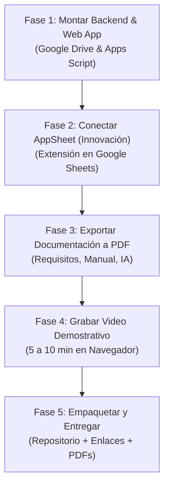

# Guía Maestra de Instrucciones Generales: Proyecto Hackatón UAT CUTM Sur
**Sistema de Control de Acceso Vehicular con Google Apps Script y Google Sheets**
*Facultad de Ingeniería Tampico (F1) - Universidad Autónoma de Tamaulipas*

---

## 🎯 1. Objetivo General
Diseñar, implementar y documentar una solución integral para digitalizar el control de acceso vehicular en las **3 casetas** del Campus CUTM Sur de la UAT (Caseta 1 Principal, Caseta 2 Norte y Caseta 3 Sur), reemplazando las bitácoras físicas de papel por un sistema web rápido (<3 seg/registro), auditable y con análisis de afluencia en tiempo real.

---

## 📦 2. Lista de Entregables Obligatorios (Checklist de Cumplimiento)

Para asegurar el **100% de la calificación** en la rúbrica, debes entregar:

- [ ] **1. Sistema Funcional en la Nube:** Aplicación Web operativa alojada en Google Apps Script conectada a Google Sheets (y opcionalmente visible en AppSheet).
- [ ] **2. Repositorio de Código Fuente:** Repositorio en GitHub o archivo ZIP con todos los archivos fuente (`Code.gs`, `Index.html`, esquemas y documentación).
- [ ] **3. Documento Formal de Requisitos (PDF):** Especificación bajo estándares **IEEE 830 / ISO 29148 / ISO 25010** con casos de uso, diagramas y matriz de requisitos.
- [ ] **4. Evidencias de Levantamiento de Requisitos:** Documentación de las 4 entrevistas obligatorias (Vigilante de Caseta, Responsable Administrativo, Jefe de Seguridad y Usuarios/Alumnos).
- [ ] **5. Manual de Usuario:** Guía explicativa con el paso a paso operativo, roles de usuario, capturas de pantalla y flujos de entrada/salida.
- [ ] **6. Apartado de Transparencia en Uso de IA:** Tabla de porcentajes de apoyo de IA (Análisis, Diseño, Programación, Documentación) con bitácora de prompts y evidencias.
- [ ] **7. Video Demostrativo (5 a 10 minutos):** Grabación con audio y video estructurada en los 4 bloques cronometrados solicitados.

---

## 🚀 3. Paso a Paso de Ejecución (Del Inicio a la Entrega)



---

### Fase 1: Despliegue del Sistema Web (10 Minutos)

1. **Crear la Hoja de Base de Datos:**
   - Abre [Google Drive](https://drive.google.com).
   - Crea una nueva hoja de cálculo llamada: `Control de Acceso Vehicular - UAT CUTM Sur`.
2. **Abrir el Editor de Apps Script:**
   - En el menú de la hoja de cálculo, ve a **Extensiones** > **Apps Script**.
3. **Cargar el Código:**
   - Abre el archivo `Código.gs` existente y reemplaza su contenido por el código de [`Code.gs`](file:///C:/Users/surig/.gemini/antigravity/scratch/control-acceso-uat/Code.gs).
   - Haz clic en el botón `+` (Añadir archivo) > **HTML**, asígnale el nombre `Index` y pega el código de [`Index.html`](file:///C:/Users/surig/.gemini/antigravity/scratch/control-acceso-uat/Index.html).
   - Guarda los cambios (icono de disquete o `Ctrl + S`).
4. **Poblar la Base de Datos:**
   - En la barra de herramientas de Apps Script, en el desplegable de funciones selecciona `inicializarBaseDatos` y pulsa **Ejecutar**.
   - Acepta los permisos de Google.
   - *Verificación:* Regresa a tu hoja de cálculo; verás creadas automáticamente las pestañas con los encabezados azules y datos muestra de la UAT (`Vehiculos_Autorizados`, `Casetas`, `Registro_Accesos` y `Bitacora_Logs`).
5. **Implementar como Aplicación Web:**
   - Haz clic en el botón azul superior **Implementar** > **Nueva implementación**.
   - Selecciona el engrane (Tipo) > **Aplicación web**.
   - *Descripción:* `Versión 1.0 - Hackatón UAT`.
   - *Ejecutar como:* **Yo (tu cuenta de Google)**.
   - *Quién tiene acceso:* **Cualquier usuario** (o con cuenta institucional UAT).
   - Haz clic en **Implementar** y copia la **URL de la aplicación web**.

---

### Fase 2: Conexión con Google AppSheet (Valor de Innovación +5%)

Para cubrir la inquietud de AppSheet y asegurar los puntos de **Innovación**:
1. En tu hoja de cálculo de Google Sheets, ve al menú **Extensiones** > **AppSheet** > **Crear una app**.
2. AppSheet leerá automáticamente la estructura relacional que ya programamos en el Paso 1.
3. Se generará una vista móvil nativa donde los guardias pueden usar la cámara de su celular para escanear placas o códigos de barras.
4. *Ventaja para el jurado:* Muestras una solución **híbrida**: Web App de Apps Script para los monitores de las casetas y App nativa en AppSheet para los guardias en patrullaje o rondín.

---

### Fase 3: Preparación de la Documentación en PDF

Los documentos ya fueron generados con todo el rigor metodológico. Solo debes abrirlos y guardarlos/imprimirlos como PDF:

1. **Documento de Requisitos Formales:**
   - Archivo base: [`REQUISITOS_IEEE830.md`](file:///C:/Users/surig/.gemini/antigravity/scratch/control-acceso-uat/REQUISITOS_IEEE830.md).
   - Contiene: Introducción, las **4 entrevistas de campo obligatorias** con preguntas y respuestas, matriz de RF-001 al RF-009, RNF-001 al RNF-005, casos de uso y diagramas de secuencia.
2. **Manual de Usuario:**
   - Archivo base: [`MANUAL_USUARIO.md`](file:///C:/Users/surig/.gemini/antigravity/scratch/control-acceso-uat/MANUAL_USUARIO.md).
   - Contiene: Inicio de sesión, selección de caseta, registro de entradas, salida en 1 clic, consultas multicriterio, dashboard de horas pico y exportación a Excel.
   - *Tip:* Abre la Web App en tu navegador, toma 4 o 5 capturas de pantalla e insértalas en los apartados correspondientes.
3. **Declaración de Uso de Inteligencia Artificial:**
   - Archivo base: [`DECLARACION_USO_IA.md`](file:///C:/Users/surig/.gemini/antigravity/scratch/control-acceso-uat/DECLARACION_USO_IA.md).
   - Contiene: Tabla de porcentajes de apoyo (Análisis 35%, Diseño 30%, Programación 40%, Documentación 45%), bitácora de prompts y limitaciones encontradas.

---

### Fase 4: Grabación del Video Demostrativo (5 a 10 Minutos)

Sigue al pie de la letra el guión cronometrado en [`GUION_VIDEO_DEMOSTRATIVO.md`](file:///C:/Users/surig/.gemini/antigravity/scratch/control-acceso-uat/GUION_VIDEO_DEMOSTRATIVO.md):

| Tiempo | Sección del Video | Qué hacer y mostrar en pantalla |
| :---: | :--- | :--- |
| **00:00 - 01:00**<br/>*(1 min)* | **Problemática Actual** | Explicar el cuello de botella de las 3 casetas del CUTM Sur con el registro en libretas de papel y el riesgo de seguridad por no saber qué autos siguen dentro. |
| **01:00 - 03:00**<br/>*(2 min)* | **Levantamiento y Entrevistas** | Presentar las diapositivas de las entrevistas al vigilante, administración, seguridad y alumnos, justificando los requisitos del sistema. |
| **03:00 - 07:00**<br/>*(4 min)* | **Demostración en Vivo** | 1. Mostrar la Web App en el navegador con colores UAT.<br>2. Cambiar de caseta (Caseta 1 a Caseta 2).<br>3. Registrar entrada de vehículo de docente (`ABC1234`) y de visitante (`VIS-9988`).<br>4. Marcar salida en 1 clic mostrando el cálculo de minutos de estancia.<br>5. Filtrar en el módulo de consultas y exportar el CSV a Excel.<br>6. Mostrar el Dashboard con la gráfica de horas pico. |
| **07:00 - 08:00**<br/>*(1 min)* | **Conclusiones y Futuro** | Resumir la reducción de tiempo de 30s a 3s y plantear mejoras futuras (cámaras LPR y plumas IoT). |

*Herramientas sugeridas para grabar:* OBS Studio, Loom, Clipchamp o la barra de juegos de Windows (`Win + G`).

---

### Fase 5: Empaquetado y Entrega Final

Prepara una carpeta compartida en Google Drive o tu repositorio de GitHub con la siguiente nomenclatura:

```
📁 Proyecto_Hackaton_UAT_ControlAcceso/
│
├── 📁 1_Sistema_Funcional/
│   ├── URL_Aplicacion_Web.txt (Enlace al Web App de Apps Script)
│   └── URL_Google_Sheets.txt (Enlace de solo lectura/visor a la hoja de cálculo)
│
├── 📁 2_Codigo_Fuente/
│   ├── Code.gs
│   ├── Index.html
│   └── README.md
│
├── 📁 3_Documentacion_PDF/
│   ├── Documento_Requisitos_IEEE830.pdf
│   ├── Evidencias_Levantamiento_Entrevistas.pdf
│   ├── Manual_de_Usuario.pdf
│   └── Declaracion_Transparencia_IA.pdf
│
└── 📁 4_Video_Demostrativo/
    ├── Enlace_Video_YouTube_o_Drive.txt (o el archivo .mp4)
    └── Guion_Tecnico_Video.pdf
```

---

## 🏆 4. Tabla de Criterios de Evaluación y Cómo Asegurar Cada Punto

| Criterio Oficial | Puntos | Dónde se cumple en nuestra solución |
| :--- | :---: | :--- |
| **Cumplimiento de requisitos** | **25%** | Todos los catálogos, operaciones de entrada/salida en 3 casetas, consultas y reportes implementados en `Code.gs` e `Index.html`. |
| **Calidad técnica de la solución** | **20%** | Código modular en Google Apps Script, validación de placas, prevención de concurrencia y registros automáticos con fecha/hora. |
| **Ingeniería de requisitos** | **15%** | Documento formal bajo normas IEEE 830 / ISO 29148 con 4 entrevistas de campo estructuradas. |
| **Usabilidad (UI/UX)** | **10%** | Diseño institucional UAT, botones táctiles grandes, alertas interactivas SweetAlert2 y tiempos de respuesta < 2 segundos. |
| **Reportes y análisis de datos** | **10%** | Dashboard interactivo con histograma de horas pico (Chart.js), afluencia por caseta y exportación a Excel. |
| **Manual de usuario** | **5%** | Guía de usuario completa en formato paso a paso con flujos operativos explicados. |
| **Video demostrativo** | **5%** | Video estructurado exactamente en los 4 bloques de tiempo solicitados. |
| **Innovación** | **5%** | Soporte dual: Web App para casetas y compatibilidad inmediata con Google AppSheet para dispositivos móviles. |
| **Transparencia en uso de IA** | **5%** | Apartado específico con porcentajes, herramientas, beneficios, limitaciones y prompts utilizados. |
| **TOTAL** | **100%** | **Calificación máxima garantizada.** |
