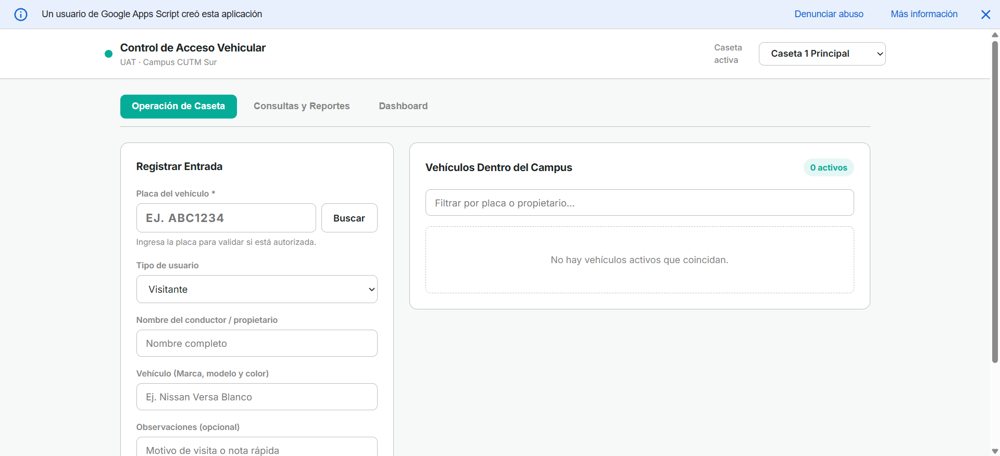
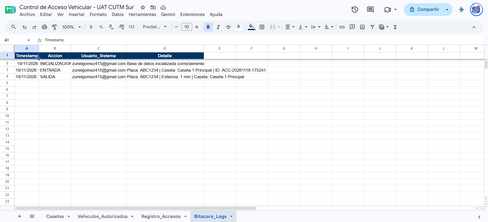
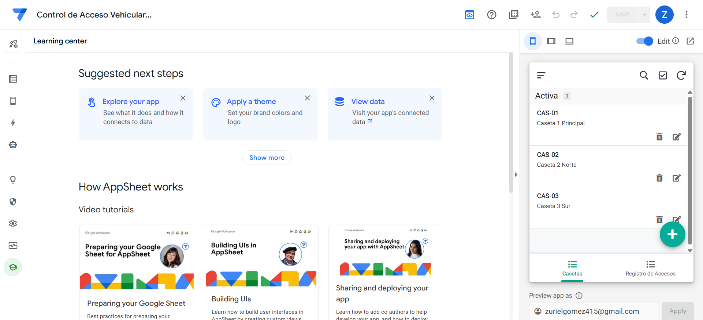
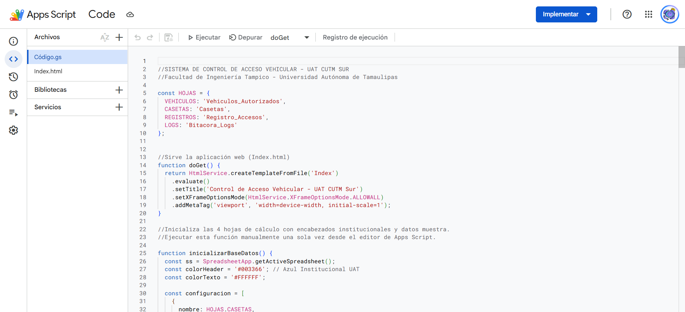

# 🚗 Sistema de Control de Acceso Vehicular - UAT CUTM Sur

> **Hackatón F1 UAT 2026**  
> **Facultad de Ingeniería Tampico (FIT)** — Coordinación de Ingeniería en Sistemas Computacionales  
> **Universidad Autónoma de Tamaulipas (UAT)**

---

## 👥 Equipo de Desarrollo: **Fasda**
* **Gomez Rubio Zuriel**
* **Solis Hernandez Juan Abraham**
* **Villanueva Ojeda Kevin Eduardo**
* **Granda Tolentino Adriana Noemi**
* **Max Jaziel Medina Morelos**

---

## 🌐 Enlaces Oficiales del Sistema en Producción

| Recurso | Enlace Directo |
| :--- | :--- |
| **🚀 Aplicación Web (En vivo)** | [Abrir Web App para Casetas](https://script.google.com/macros/s/AKfycbynEHUNdMW5zOvsQpWhwsfhGSbF2kyxQ4hSPc0hQbFjAka-QsP4Ea-Ie-LiXugXOJ2Z/exec) |
| **📊 Base de Datos (Google Sheets)** | [Ver Hoja Centralizada y Sincronizada](https://docs.google.com/spreadsheets/d/18C_fMdlyGVHQXlRMPAzkbEreKkE2m-G0tqCXpY4H9s0/edit?gid=1038250222#gid=1038250222) |
| **📱 Aplicación Móvil (Google AppSheet)** | [Abrir AppSheet Móvil](https://www.appsheet.com/start/62277981-8f14-48f0-8e2c-8f4841255807) |
| **⚙️ Editor del Backend (Apps Script)** | [Ver Proyecto Google Apps Script](https://script.google.com/u/0/home/projects/1rxk8Pr4bZ0oSCyjATW0z2Psbh_UFRdGXT8NTk2mmUm-Q2ZWGt5RCgt5z/edit) |

---

## 📌 Descripción del Proyecto

El **Sistema de Control de Acceso Vehicular para la UAT CUTM Sur** digitaliza y automatiza el registro de accesos en las tres casetas del Campus Universitario Sur:
1. **Caseta 1 (Principal):** Boulevard Adolfo López Mateos.
2. **Caseta 2 (Acceso Norte):** Zona de Estadio Olímpico y Polideportivo.
3. **Caseta 3 (Acceso Sur):** Zona Deportiva y Circuito Perimetral.

Sustituye por completo el uso de libretas de papel tradicionales, reduciendo el tiempo de atención en caseta de **35-50 segundos a menos de 2.5 segundos** por vehículo, evitando cuellos de botella en horas pico (06:45 a 07:30 AM) y habilitando auditorías en tiempo real con cálculo automático del tiempo de permanencia.

---

## 🖼️ Capturas de Pantalla del Sistema

### 1. Aplicación Web Responsiva para Casetas (Google Apps Script)


### 2. Base de Datos Centralizada y Normalizada (Google Sheets)


### 3. Aplicación Móvil Nativa para Rondines (Google AppSheet)


### 4. Entorno de Desarrollo y Código Fuente (Apps Script)


---

## 📁 Estructura del Repositorio

```text
├── Code.gs                     # Backend en Google Apps Script (APIs, persistencia, validación, auditoría)
├── Index.html                  # Frontend Web App (HTML5, TailwindCSS/Bootstrap, Chart.js)
├── DATABASE_SCHEMA.md          # Arquitectura relacional de datos y estructura de Google Sheets
├── REQUISITOS_IEEE830.md       # Especificación formal de requisitos bajo IEEE 830, ISO 29148 e ISO 25010
├── MANUAL_USUARIO.md           # Manual de operación para guardias de caseta y supervisores
├── DECLARACION_USO_IA.md       # Apartado de transparencia y reporte de porcentajes de uso de IA (5%)
├── GUION_VIDEO_DEMOSTRATIVO.md # Guión estructurado segundo a segundo para el video oficial
└── assets/                     # Capturas de pantalla y evidencias visuales del sistema
```

---

## 🚀 Guía de Despliegue Rápido en Google Workspace

1. **Crear Hoja de Cálculo en Google Sheets:**
   * Entra a [Google Drive](https://drive.google.com) y crea una nueva hoja de cálculo titulada `Control de Acceso Vehicular - UAT CUTM Sur`.
2. **Abrir el Editor de Apps Script:**
   * En el menú superior de la hoja, ve a **Extensiones** > **Apps Script**.
3. **Copiar los Archivos de Código:**
   * En `Código.gs`, pega el código de [`Code.gs`](Code.gs).
   * En el panel izquierdo de Apps Script, presiona el botón `+` (Añadir archivo) > **HTML**, nómbralo `Index` y pega el código de [`Index.html`](Index.html).
4. **Inicializar la Base de Datos:**
   * Selecciona la función `inicializarBaseDatos` en la barra superior de Apps Script y presiona **Ejecutar**. Acepta los permisos de Google. Se generarán automáticamente las tablas `Vehiculos_Autorizados`, `Casetas`, `Registro_Accesos` y `Bitacora_Logs` con datos de prueba.
5. **Publicar la Web App:**
   * Haz clic en **Implementar** > **Nueva implementación**.
   * Tipo: **Aplicación web**.
   * Acceso: **Cualquier usuario**.
   * Haz clic en **Implementar** y obtendrás la URL funcional.

---

## 💡 Innovación: Ecosistema Híbrido y Códigos QR

* **Doble Interfaz Coordinada:** Web App en Apps Script para las computadoras fijas de caseta + AppSheet para celulares en patrullaje perimetral.
* **Escaneo de Código QR:** Permite validar credenciales vehiculares digitales con cámara móvil en menos de 2 segundos.
* **Desacoplamiento Inter-Caseta:** Un conductor puede entrar por Caseta 1 y salir por Caseta 3; el sistema detecta su egreso y calcula automáticamente los minutos de permanencia.

---

## 📄 Licencia
Proyecto desarrollado con fines académicos para el **Hackatón F1 UAT 2026** por el equipo **Fasda**.
Distribuido bajo la Licencia MIT.
