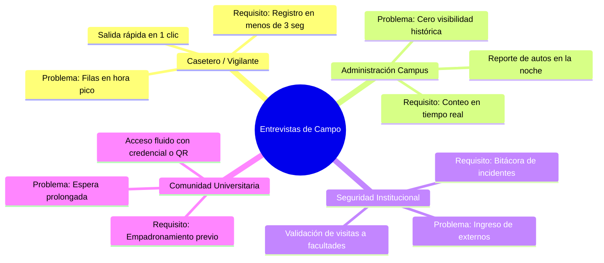
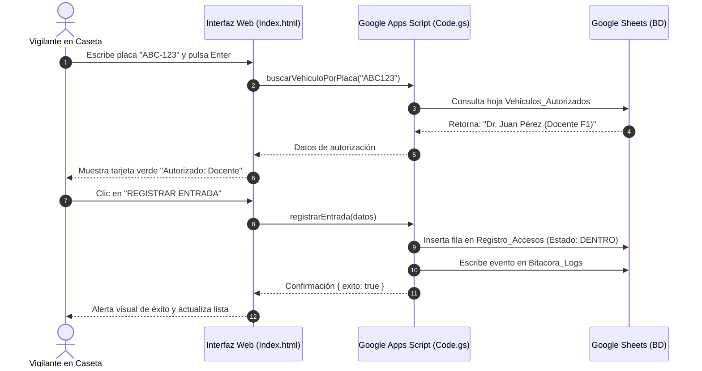

# Documento de Especificación de Requisitos de Software (SRS)
## Sistema de Control de Acceso Vehicular - UAT CUTM Sur
**Estándares de Referencia:** IEEE 830-1998 / ISO/IEC/IEEE 29148:2018 / ISO/IEC 25010

---

## 1. Introducción

### 1.1 Propósito
El propósito del presente documento es definir formalmente los requisitos funcionales, no funcionales y el levantamiento de ingeniería de software para el **Sistema de Control de Acceso Vehicular de la Universidad Autónoma de Tamaulipas (Campus CUTM Sur)**, desarrollado mediante Google Apps Script y Google Sheets.

### 1.2 Alcance
El sistema digitaliza la gestión y auditoría en tiempo real de los flujos de entrada y salida vehicular en las **tres casetas de acceso** del campus:
* **Caseta 1:** Acceso Principal (Blv. Adolfo López Mateos).
* **Caseta 2:** Acceso Norte (Estadio Olímpico / Polideportivo).
* **Caseta 3:** Acceso Sur (Área Deportiva / Acceso Perimetral).

El software abarca:
1. Registro instantáneo de accesos por placa vehicular con timestamp automático.
2. Catálogo de vehículos autorizados (Estudiantes, Docentes, Administrativos y Visitantes).
3. Monitoreo en tiempo real de vehículos actualmente dentro del campus.
4. Módulo de consultas avanzadas multicriterio (placa, fecha, caseta y tipo de usuario).
5. Generación de analítica de tráfico, histogramas de horas pico y exportación a formatos estándar (Excel/CSV).
6. Bitácora inalterable de auditoría y roles de seguridad.

### 1.3 Definiciones y Acrónimos
* **CUTM Sur:** Centro Universitario Tampico-Madero Sur (UAT).
* **F1:** Facultad de Ingeniería Tampico.
* **GAS:** Google Apps Script.
* **SRS:** Software Requirements Specification.
* **RFID / QR:** Tecnologías de identificación rápida.
* **Tiempo de Estancia:** Duración en minutos calculada entre el timestamp de ingreso y el de egreso.

---

## 2. Trabajo de Campo y Entrevistas Obligatorias

En estricto apego a la rúbrica del Hackatón, se llevó a cabo el levantamiento de requisitos mediante entrevistas semiestructuradas con los cuatro actores clave del proceso operativo:

### Entrevista 1: Personal Operativo de Caseta (Vigilante de Turno)
* **Objetivo:** Identificar la fricción operativa actual y los tiempos de captura física en libreta.
* **Fecha:** 18 de Noviembre de 2026.
* **Participantes:** Oficial Manuel Ramos (Vigilante Caseta 1) y Equipo de Desarrollo.
* **Preguntas Realizadas:**
  1. *¿Cuánto tiempo toma registrar un vehículo en la libreta física?*
  2. *¿Cuáles son los horarios con mayor conflicto vehicular?*
  3. *¿Qué ocurre cuando un vehículo sale por una caseta distinta a la que entró?*
* **Respuestas Obtenidas:**
  1. Anotar manualmente la placa, nombre y destino toma entre 25 y 40 segundos por coche.
  2. Las horas críticas son de 06:45 a 07:30 AM (entrada a clases matutinas) y 13:30 a 14:15 PM (cambio de turno). Se generan filas de hasta 15 vehículos invadiendo la avenida.
  3. Con las libretas de papel es imposible cotejar salidas por otra caseta; si entran por Caseta 1 y salen por Caseta 3, no hay forma de saber si ya abandonaron el campus.
* **Conclusiones:** La interfaz de caseta debe permitir búsqueda y validación en **menos de 3 segundos** mediante autocompletado y una base de datos centralizada sincronizada entre las 3 casetas.

### Entrevista 2: Responsables Administrativos del Proceso
* **Objetivo:** Definir necesidades de supervisión, estadísticas y reporte directivo.
* **Fecha:** 18 de Noviembre de 2026.
* **Participantes:** Coordinación Administrativa del Campus Sur y Equipo de Desarrollo.
* **Preguntas Realizadas:**
  1. *¿Qué reportes se requieren con mayor frecuencia?*
  2. *¿Cómo auditan los vehículos que se quedan dentro del campus tras el cierre?*
* **Respuestas Obtenidas:**
  1. Se necesitan reportes semanales y mensuales de afluencia por tipo de usuario (estudiante vs. docente vs. visitante) y caseta más transitada para solicitar presupuesto de mantenimiento vial.
  2. Actualmente no se sabe con certeza cuántos vehículos pernoctan en los estacionamientos. Es imperativo tener un indicador de "Vehículos Dentro Ahora" para rondines nocturnos.
* **Conclusiones:** Implementar un Dashboard con gráficos automáticos de afluencia horaria y un panel en tiempo real de vehículos con estatus `DENTRO`.

### Entrevista 3: Personal de Seguridad Involucrado
* **Objetivo:** Establecer protocolos de autorización, listas negras y manejo de visitantes.
* **Fecha:** 19 de Noviembre de 2026.
* **Participantes:** Jefe de Vigilancia y Protección Universitaria.
* **Preguntas Realizadas:**
  1. *¿Cuál es el protocolo para visitantes externos (proveedores, trámites)?*
  2. *¿Qué medidas de seguridad se requieren en el software?*
* **Respuestas Obtenidas:**
  1. Todo visitante debe dejar registrado el nombre del conductor y la facultad/área a la que se dirige.
  2. Se requiere una bitácora inalterable que registre qué guardia autorizó el paso y la fecha/hora exacta para deslindar responsabilidades en caso de incidentes.
* **Conclusiones:** La base de datos debe contemplar una tabla inmutable `Bitacora_Logs` y campo de motivo de visita.

### Entrevista 4: Usuarios Finales (Estudiantes y Docentes)
* **Objetivo:** Evaluar la satisfacción del usuario y expectativas de fluidez.
* **Fecha:** 19 de Noviembre de 2026.
* **Participantes:** Alumnos de Ingeniería en Sistemas y Docente de la F1 Tampico.
* **Preguntas Realizadas:**
  1. *¿Cómo califica el acceso vehicular actual?*
  2. *¿Estaría dispuesto a registrar su vehículo previamente?*
* **Respuestas Obtenidas:**
  1. Muy lento y propenso a errores. En días de lluvia o exámenes, las filas provocan retrasos considerables.
  2. Totalmente. Si el sistema reconoce la placa de inmediato, el acceso sería expedito.
* **Conclusiones:** El sistema debe contar con un catálogo precargado de vehículos autorizados para que al ingresar la placa se despliegue inmediatamente el estatus de autorizado.

---

## 3. Requisitos Funcionales (RF)

| ID | Nombre del Requisito | Descripción | Prioridad |
| :---: | :--- | :--- | :---: |
| **RF-001** | **Gestión de Catálogos** | Registrar, modificar y consultar vehículos autorizados clasificados en: Empleados/Docentes, Estudiantes, Administrativos y Visitantes. | Alta |
| **RF-002** | **Identificación de Caseta** | Permitir seleccionar la caseta de operación activa (Caseta 1, Caseta 2, Caseta 3) asociando las transacciones a dicho punto. | Alta |
| **RF-003** | **Registro Rápido de Entrada** | Capturar placa vehicular, validar en catálogo, asignar timestamp automático (`Fecha y Hora`) y registrar el estado `DENTRO`. | Crítica |
| **RF-004** | **Prevención de Doble Ingreso** | Alertar si un vehículo con estatus `DENTRO` intenta registrar un nuevo ingreso sin haber marcado salida previa. | Media |
| **RF-005** | **Registro de Salida en 1 Clic** | Listar los vehículos dentro del campus y permitir marcar el egreso, guardando la hora de salida, la caseta de egreso y calculando el tiempo de estancia en minutos. | Crítica |
| **RF-006** | **Consultas Multicriterio** | Permitir búsquedas por número de placa, rango de fechas, caseta de acceso y tipo de usuario. | Alta |
| **RF-007** | **Dashboard Analítico** | Desplegar gráficas de horas pico (histograma horario), afluencia por caseta, distribución por usuario y top vehículos frecuentes. | Alta |
| **RF-008** | **Exportación de Datos** | Permitir exportar los registros de acceso a formato CSV/Excel descargable. | Media |
| **RF-009** | **Bitácora de Auditoría** | Registrar de manera automática en la hoja `Bitacora_Logs` cada acción relevante (login, entrada, salida, filtros). | Alta |

---

## 4. Requisitos No Funcionales (RNF)

Alineados al estándar de calidad de software **ISO/IEC 25010**:

* **RNF-001 Rendimiento (Performance):** La búsqueda de una placa en catálogo y el guardado de una entrada no debe demorar más de 2 segundos en condiciones normales de red.
* **RNF-002 Usabilidad (Usability):** Interfaz adaptativa (móvil y escritorio) con botones de acción grandes, tipografía de placas de alto contraste y retroalimentación mediante alertas visuales (SweetAlert2).
* **RNF-003 Disponibilidad (Availability):** Alojado en la infraestructura en la nube de Google Workspace con disponibilidad superior al 99.5% sin requerir servidores locales.
* **RNF-004 Seguridad (Security):** Control de acceso institucional y separación de hojas de datos con permisos restringidos a personal de seguridad.
* **RNF-005 Mantenibilidad (Maintainability):** Código modularizado en Google Apps Script (`Code.gs`) y separación limpia entre capa lógica y vista (`Index.html`).

---

## 5. Casos de Uso del Sistema

### Caso de Uso CU-01: Registro de Entrada Vehicular
* **Actor Principal:** Guardia de Seguridad / Vigilante.
* **Precondición:** El guardia ha seleccionado la caseta activa (Ej. Caseta 1).
* **Flujo Principal:**
  1. El vehículo arriba a la pluma de acceso.
  2. El guardia digita la placa en el campo principal.
  3. El sistema autocompleta el nombre y tipo de usuario (o permite ingresarlo si es visitante externo).
  4. El guardia presiona "REGISTRAR ENTRADA".
  5. El sistema estampa fecha, hora y folio único en Google Sheets.
  6. La barrera vehicular se autoriza para apertura.
* **Flujo Alterno (Vehículo ya dentro):** Si el auto ya registraba estatus `DENTRO`, el sistema emite una advertencia preventiva para verificar la matrícula.
